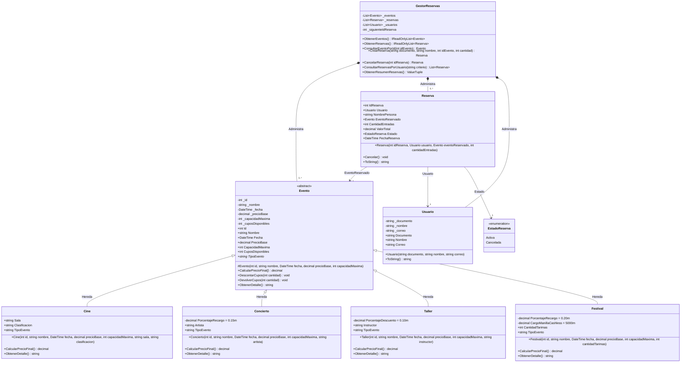

# PLANAZO — Sistema de Gestión de Eventos y Reservas (POO en C# y .NET)

**Asignatura:** Programación con C# y .NET  
**Modalidad:** Individual  
**Tipo de aplicación:** Consola (`.NET 8.0`)  
**Repositorio:** `PLANAZO-POO-CSharp`

## 1. Descripción de la aplicación

**PLANAZO** es una aplicación de consola desarrollada en **C# y .NET** para gestionar las actividades de entretenimiento organizadas por la empresa (funciones de cine, conciertos, talleres y festivales). El sistema permite consultar el catálogo de eventos disponibles, calcular automáticamente el precio final de cada entrada según las reglas de negocio de cada categoría mediante **polimorfismo**, registrar reservas asociando usuarios con eventos, controlar en tiempo real el inventario de cupos disponibles, cancelar reservas devolviendo los cupos correspondientes y visualizar estadísticas consolidadas de las reservas activas.

## 2. Funcionalidades implementadas

1. **Catálogo inicial precargado:** Inicia con **7 eventos registrados** (2 películas de cine, 2 conciertos, 2 talleres y 1 festival adicional correspondiente al Reto 1).
2. **Cálculo polimórfico de precios (`decimal`):**
   - `Cine`: mantiene el precio base ($0\%$ de recargo/descuento).
   - `Concierto`: incrementa el precio base en un $+15\%$ (ej. $\$50.000 \rightarrow \$57.500$).
   - `Taller`: aplica un descuento del $-10\%$ sobre el precio base (ej. $\$40.000 \rightarrow \$36.000$).
   - `Festival` *(Reto Adicional 1)*: aplica un recargo del $+20\%$ por logística más un cargo fijo de $\$5.000$ por manilla *Cashless* (ej. $\$100.000 \rightarrow \$125.000$).
3. **Gestión integral de reservas y control de cupos:**
   - Validación que impide reservar cantidades menores o iguales a cero.
   - Validación que impide reservar más entradas que los cupos disponibles del evento.
   - Descuento automático de cupos al confirmar la reserva.
   - Devolución automática de cupos al cancelar una reserva activa.
   - Bloqueo contra doble cancelación de una misma reserva.
4. **Gestión y consulta por Usuario *(Reto Adicional 2)*:**
   - Registro e identificación de clientes mediante la clase `Usuario` (`Documento`, `Nombre`, `Correo`).
   - Consulta filtrada de todas las reservas históricas o activas asociadas a un usuario específico.
5. **Resumen estadístico en tiempo real:**
   - Reporte de cantidad total de reservas activas, total de entradas reservadas activas y valor monetario total recaudado.
6. **Manejo robusto de excepciones:**
   - Uso de bloques `try-catch` y excepciones específicas (`ArgumentException`, `InvalidOperationException`, `KeyNotFoundException`, `FormatException`) para evitar cierres inesperados ante entradas inválidas.

## 3. Estructura del proyecto

```text
PLANAZO-POO-CSharp/
│
├── PLANAZO.csproj
├── Program.cs
│
├── Modelos/
│   ├── Evento.cs
│   ├── Cine.cs
│   ├── Concierto.cs
│   ├── Taller.cs
│   ├── Festival.cs
│   ├── Usuario.cs
│   └── Reserva.cs
│
├── Servicios/
│   └── GestorReservas.cs
│
├── Capturas/
│   ├── Caso 1 (Registrar reserva válida y descontar cupos).png
│   ├── Caso 2 (Intentar reservar más entradas que los cupos disponibles).png
│   ├── Caso 3 (Intentar reservar cantidad negativa).png
│   ├── Caso 4 (Cancelar reserva y devolver cupos).png
│   ├── Caso 5 (Intentar cancelar dos veces la misma reserva).png
│   ├── Caso 6 (Consultar evento inexistente).png
│   └── Caso 7 (Precios finales polimórficos).png
│
├── README.md
└── .gitignore
```

## 4. Instrucciones para ejecutar el proyecto con `dotnet run`

### Prerrequisitos

- Tener instalado el SDK de **.NET 6.0, 7.0 u 8.0** ([Descargar .NET](https://dotnet.microsoft.com/download)).

### Pasos de ejecución

1. Clonar el repositorio y ubicarse en la carpeta raíz del proyecto:

   ```bash
   git clone https://github.com/itohdez/PLANAZO-POO-CSharp.git
   cd PLANAZO-POO-CSharp
   ```

2. Compilar y ejecutar la aplicación directamente con el CLI de .NET:

   ```bash
   dotnet run
   ```

## 5. Explicación de las clases desarrolladas y sus relaciones

| Clase / Enum | Ubicación | Responsabilidad y relación con otras clases |
| :--- | :--- | :--- |
| `Evento` *(abstracta)* | `Modelos/Evento.cs` | Clase base que define los atributos comunes (`Id`, `Nombre`, `Fecha`, `PrecioBase`, `CapacidadMaxima`, `CuposDisponibles`), los métodos de control de inventario (`DescontarCupos`, `DevolverCupos`) y el contrato abstracto `CalcularPrecioFinal()`. |
| `Cine` | `Modelos/Cine.cs` | Hereda de `Evento` (**Herencia "es-un"**). Añade `Sala` y `Clasificacion`, e implementa `CalcularPrecioFinal()` retornando `PrecioBase`. |
| `Concierto` | `Modelos/Concierto.cs` | Hereda de `Evento`. Añade la propiedad `Artista` y sobrescribe `CalcularPrecioFinal()` aplicando un $+15\%$ sobre `PrecioBase`. |
| `Taller` | `Modelos/Taller.cs` | Hereda de `Evento`. Añade la propiedad `Instructor` y sobrescribe `CalcularPrecioFinal()` aplicando un $-10\%$ sobre `PrecioBase`. |
| `Festival` *(Reto 1)* | `Modelos/Festival.cs` | Hereda de `Evento`. Añade `CantidadTarimas` y sobrescribe `CalcularPrecioFinal()` sumando un $+20\%$ más $\$5.000$ de manilla *Cashless*. |
| `Usuario` *(Reto 2)* | `Modelos/Usuario.cs` | Representa a la persona que realiza una reserva (`Documento`, `Nombre`, `Correo`). Se asocia con `Reserva`. |
| `Reserva` | `Modelos/Reserva.cs` | Relaciona por **composición/asociación** un `Usuario` con un `Evento` (`EventoReservado`), almacena la `CantidadEntradas`, calcula el `ValorTotal` invocando polimórficamente a `eventoReservado.CalcularPrecioFinal()` y administra su `Estado` (`Activa` o `Cancelada`). |
| `GestorReservas` | `Servicios/GestorReservas.cs` | Administra las colecciones `List<Evento>`, `List<Reserva>` y `List<Usuario>`. Centraliza la lógica de negocio para búsqueda, creación, cancelación y cálculo de resúmenes. |
| `Program` | `Program.cs` | Capa de presentación en consola: despliega el menú interactivo, captura datos del usuario y gestiona las excepciones de forma segura. |

## 6. Aplicación de los pilares de Programación Orientada a Objetos

- **Encapsulamiento:** Todos los campos internos de `Evento`, `Usuario`, `Reserva` y `GestorReservas` son privados (`private`) y sus propiedades públicas tienen modificadores `private set`. El número de `CuposDisponibles` no puede alterarse libremente desde fuera de la clase `Evento`; únicamente puede modificarse a través de los métodos `DescontarCupos(int cantidad)` y `DevolverCupos(int cantidad)`, los cuales validan que no se descuente más del aforo disponible ni se supere la `CapacidadMaxima`. Asimismo, `GestorReservas` expone sus listas como `IReadOnlyList<T>` para evitar manipulaciones externas directas.
- **Abstracción:** La clase `public abstract class Evento` modela el concepto general de un evento sin permitir su instanciación directa (`new Evento(...)` no es válido), exponiendo únicamente las operaciones esenciales (`CalcularPrecioFinal()`, `DescontarCupos()`, `DevolverCupos()`, `ObtenerDetalle()`).
- **Herencia:** Las clases `Cine`, `Concierto`, `Taller` y `Festival` heredan de `Evento` (`: Evento`), reutilizando el constructor base (`: base(...)`), las validaciones de atributos y la lógica de control de cupos sin duplicar código.
- **Polimorfismo:** El método `public abstract decimal CalcularPrecioFinal()` es sobrescrito (`override`) en cada subclase con su propia fórmula. Cuando la clase `Reserva` calcula `ValorTotal = eventoReservado.CalcularPrecioFinal() * cantidadEntradas`, no necesita usar condicionales `if/switch` para saber si el evento es un `Cine`, `Concierto`, `Taller` o `Festival`: en tiempo de ejecución se invoca automáticamente la implementación correspondiente.

## 7. Diagrama de Clases UML (Reto Adicional 3)



## 8. Pregunta de sustentación

> **¿Por qué utilizaste una clase abstracta `Evento` en lugar de crear clases completamente independientes para Cine, Concierto y Taller? ¿Qué ventajas tiene esta decisión cuando necesitamos agregar un nuevo tipo de evento?**

### Respuesta justificada

Utilicé una clase abstracta porque Cine, Concierto y Taller tienen casi todo en común: los tres tienen id, nombre, fecha, precio base, capacidad y cupos, y los tres reservan y liberan cupos de la misma manera. Si hubiera creado tres clases independientes, habría tenido que copiar ese código tres veces, y cualquier cambio (por ejemplo, una validación nueva en `ReservarCupos`) habría que repetirlo en cada una. Con `Evento` ese código está escrito una sola vez y los hijos lo reutilizan.

Lo único que cambia entre los tipos es cómo se calcula el precio, y para eso `Evento` declara el método abstracto `CalcularPrecioFinal()`. Esto obliga a cada hijo a escribir su propia regla: en `Concierto` es `PrecioBase * (1 + Recargo)` y en `Taller` es `PrecioBase * (1 - Descuento)`. Gracias a esto, `Reserva` y `GestorReservas` solo trabajan con el tipo `Evento`: en `Reserva` la línea `evento.CalcularPrecioFinal() * cantidadEntradas` funciona igual sin importar si el evento es de cine, un concierto o un taller (polimorfismo), y todos caben en una sola `List<Evento>`.

La ventaja principal se ve al agregar un tipo nuevo. Para el Reto 1 creé `Festival`: solo escribí `Festival.cs` heredando de `Evento` e implementando su `CalcularPrecioFinal()` (25 % de recargo más un cargo fijo), y lo registré con `gestor.RegistrarEvento(new Festival(...))` en `Program.cs`. **No tuve que modificar** `Reserva`, `GestorReservas`, `Cine`, `Concierto` ni `Taller`. Es decir, el sistema está abierto para crecer, pero cerrado para no romper lo que ya funciona. Con clases independientes habría tenido que tocar el gestor y la lista de eventos para cada tipo nuevo.

## 9. Evidencias y Casos de Prueba

Las capturas de pantalla con la ejecución de los **7 casos de prueba** exigidos se encuentran en la carpeta [`Capturas/`](./Capturas):

1. **Caso 1 — Registrar una reserva válida y descontar cupos:**  
   Archivo: [`Capturas/Caso 1 (Registrar reserva válida y descontar cupos).png`](./Capturas/Caso%201%20%28Registrar%20reserva%20válida%20y%20descontar%20cupos%29.png)
   [./Capturas/Caso%201%20%28Registrar%20reserva%20válida%20y%20descontar%20cupos%29.png]

2. **Caso 2 — Intentar reservar más entradas que los cupos disponibles:**  
   Archivo: [`Capturas/Caso 2 (Intentar reservar más entradas que los cupos disponibles).png`](./Capturas/Caso%202%20%28Intentar%20reservar%20más%20entradas%20que%20los%20cupos%20disponibles%29.png)
   [./Capturas/Caso%202%20%28Intentar%20reservar%20más%20entradas%20que%20los%20cupos%20disponibles%29.png]

3. **Caso 3 — Intentar realizar una reserva con una cantidad negativa:**  
   Archivo: [`Capturas/Caso 3 (Intentar reservar cantidad negativa).png`](./Capturas/Caso%203%20%28Intentar%20reservar%20cantidad%20negativa%29.png)
   [./Capturas/Caso%203%20%28Intentar%20reservar%20cantidad%20negativa%29.png]

4. **Caso 4 — Cancelar una reserva y comprobar que se devuelven los cupos:**  
   Archivo: [`Capturas/Caso 4 (Cancelar reserva y devolver cupos).png`](./Capturas/Caso%204%20%28Cancelar%20reserva%20y%20devolver%20cupos%29.png)
   [./Capturas/Caso%204%20%28Cancelar%20reserva%20y%20devolver%20cupos%29.png]

5. **Caso 5 — Intentar cancelar dos veces la misma reserva:**  
   Archivo: [`Capturas/Caso 5 (Intentar cancelar dos veces la misma reserva).png`](./Capturas/Caso%205%20%28Intentar%20cancelar%20dos%20veces%20la%20misma%20reserva%29.png)
   [./Capturas/Caso%205%20%28Intentar%20cancelar%20dos%20veces%20la%20misma%20reserva%29.png]

6. **Caso 6 — Consultar un evento inexistente:**  
   Archivo: [`Capturas/Caso 6 (Consultar evento inexistente).png`](./Capturas/Caso%206%20%28Consultar%20evento%20inexistente%29.png)
   [./Capturas/Caso%206%20%28Consultar%20evento%20inexistente%29.png]

7. **Caso 7 — Comprobar que cada tipo de evento calcula correctamente su precio final:**  
   Archivo: [`Capturas/Caso 7 (Precios finales polimórficos).png`](./Capturas/Caso%207%20%28Precios%20finales%20polimórficos%29.png)
   [./Capturas/Caso%207%20%28Precios%20finales%20polimórficos%29.png]
